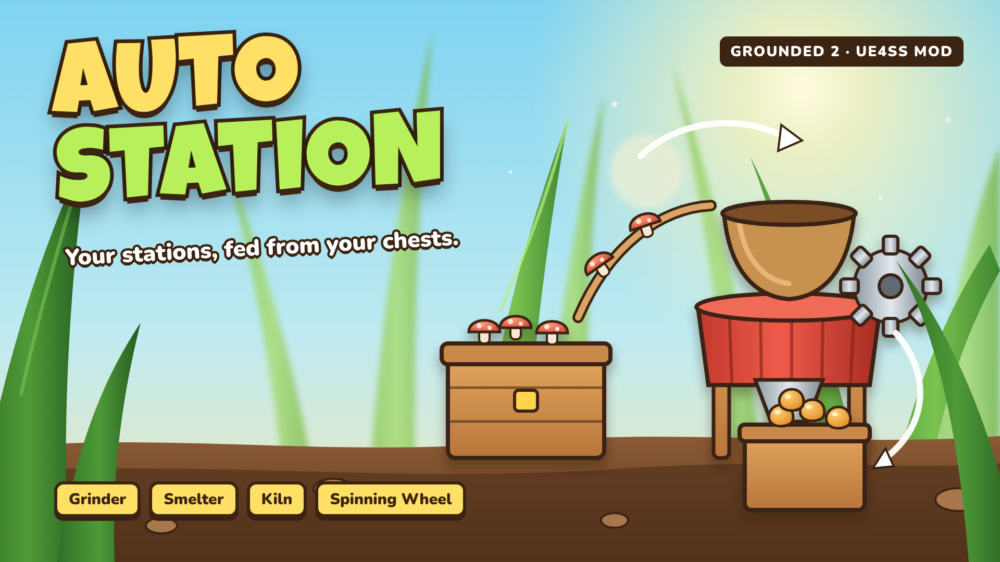

<p align="center">
  
</p>

# AutoStation — Grounded 2 (beta)

Keeps your production stations running from your chests. Queue a recipe on a grinder, smelter,
kiln, spinning wheel (and more) **once** by hand — AutoStation keeps refilling it from nearby
chests and stores the results in the chest where you already keep them.

> 🇧🇷 [Leia em português](#português)

## Features

- **Learns from you:** queue a recipe by hand once and that station is tracked with that recipe.
- **Auto refill:** the queue is topped up with the same recipe. The game itself takes the
  ingredients from nearby chests, exactly like normal crafting — nothing is spawned.
- **Auto store:** finished items go **straight** into a nearby chest that **already holds that item** (never through your backpack).
  If no chest holds it, they stay in the station.
- **Backpack-safe:** if a refill ever takes ingredients from your backpack (chests ran out),
  that station stops.
- **Keeps a reserve:** stops refilling before an ingredient drops below 10 in the chests
  (configurable, per item too), so you always have some left for building and crafting.
- **Stops when you want:** cancel an item from the station's queue by hand, or press `Ctrl+F5`.
- Works with the Refinery/Grinder, Smelter, Kiln, Spinning Wheel, Cooking Station, Glue Factory,
  Paint Mixer, Drying Rack, Grill and Mash Bowl.

## Requirements

- Grounded 2 (Steam)
- [UE4SS for Grounded 2](https://www.nexusmods.com/grounded2/mods/259)

## Installation

1. Install **UE4SS for Grounded 2** into
   `...\steamapps\common\Grounded2\Augusta\Binaries\Win64\`
2. Copy the `AutoStation` folder into
   `...\Grounded2\Augusta\Binaries\Win64\ue4ss\Mods\`
   (it already contains `enabled.txt`).

**Back up your save first** (`%USERPROFILE%\Saved Games\Grounded2`) — this is a beta.

## Usage

1. Stand at a station with chests nearby and queue a recipe by hand.
2. Keep playing nearby. Every few seconds the station is refilled and finished items are stored.

| Hotkey | Action |
|---|---|
| `Ctrl+F5` | Toggle tracking of the nearest station |
| `Ctrl+F11` | List tracked stations in the log |

## Limitations (beta)

- Works only while you are near the station (40 m by default): the game only uses chests close
  to the player for crafting.
- Tracking resets when the game restarts: queue once by hand again, or press `Ctrl+F5` at the station.
- Host only in multiplayer.

## Configuration

Top of `AutoStation/Scripts/main.lua`:

```lua
local Config = {
    TickMs          = 3000,  -- how often tracked stations are checked
    ChestRadius     = 1500,  -- cm (15 m) around the station
    ActiveRadius    = 4000,  -- cm (40 m): only stations this close to you work
    MaxFeedsPerTick = 2,
    StationsPerTick = 3,     -- stations handled per tick
    IdleSeconds     = 30,    -- rest time when no ingredients are nearby
    Verbose         = false, -- log every move
    Reserve         = 10,    -- keep at least this many of each ingredient in the chests
    ReserveByItem   = {},    -- e.g. { ["MushroomChunk"] = 50, ["FiberRaw"] = 0 }
}
```

## Troubleshooting

`...\Win64\ue4ss\UE4SS.log`, lines starting with `[AutoStation]`. Open an issue with the log.

## Uninstall

Delete the `ue4ss\Mods\AutoStation` folder.

## Credits

[UE4SS](https://github.com/UE4SS-RE/RE-UE4SS) team. Not affiliated with Obsidian Entertainment,
Xbox Game Studios or Microsoft.

---

## Português

Mantém as suas estações de produção funcionando com o que está nos baús. Coloque uma receita
**uma vez** à mão no moedor, fornalha, forno, roda de fiar etc. — o AutoStation repõe a fila com
os ingredientes dos baús próximos e guarda o resultado no baú onde você já guarda aquele item
(se nenhum baú tiver, fica na estação).

- Mantém uma reserva: para de repor antes de um ingrediente ficar abaixo de 10 nos baús
  (configurável em `Reserve` / `ReserveByItem`), e volta sozinha quando você reabastece.
- Se faltar no baú e o jogo tentar usar a sua mochila, a estação para.
- Cancelar um item da fila à mão (ou `Ctrl+F5`) para a estação.
- Funciona com você por perto (40 m). Só o anfitrião no multiplayer.
- **Faça backup do save antes** (`%USERPROFILE%\Saved Games\Grounded2`).

Instalação: instale o UE4SS for Grounded 2 e copie a pasta `AutoStation` para `...\Win64\ue4ss\Mods\`.

## License

[MIT](LICENSE)
